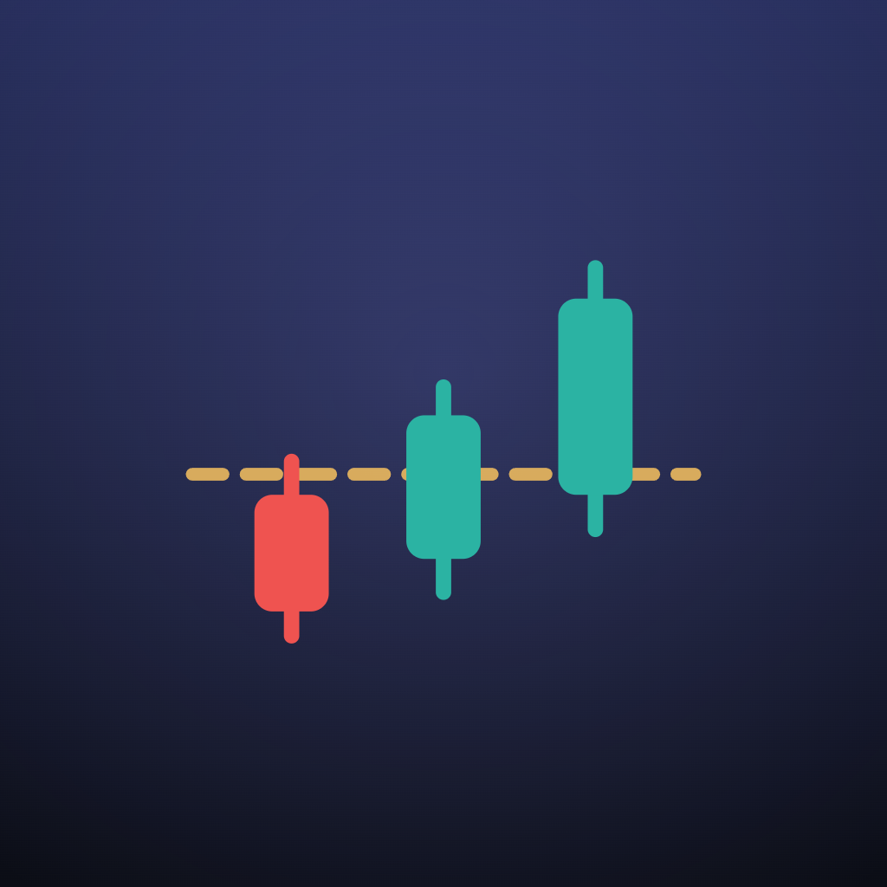
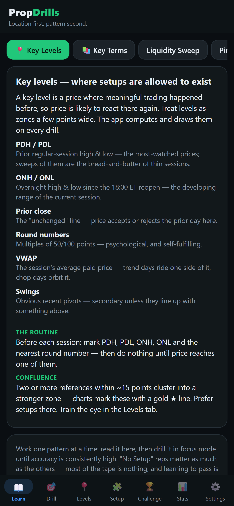
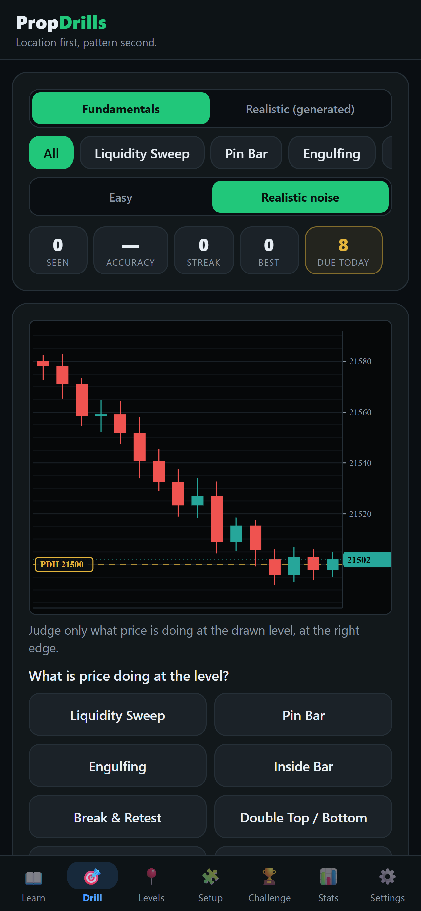
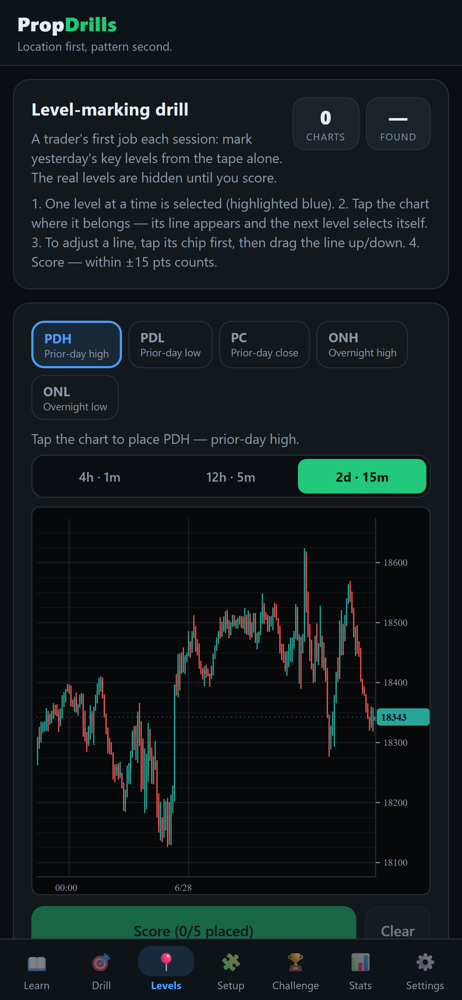
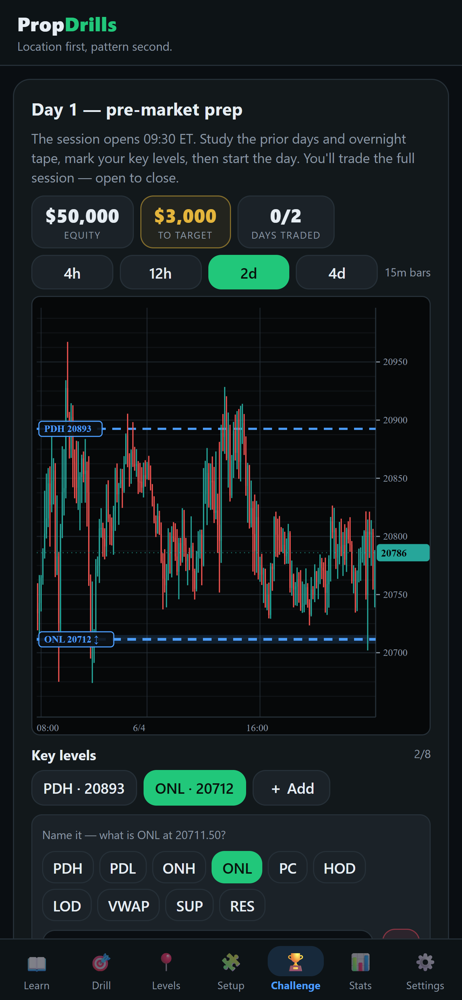
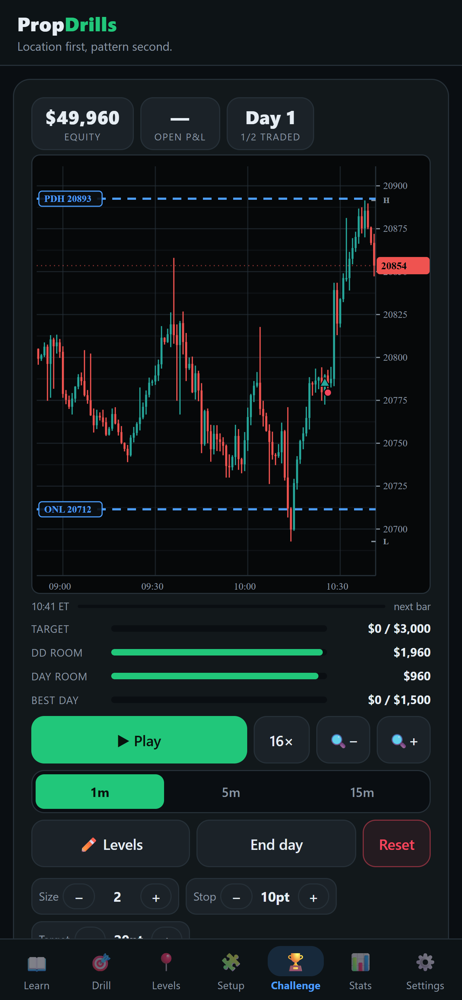

<p align="center">
  
</p>

<h1 align="center">PropDrills</h1>

<p align="center">
  An MNQ price-action setup trainer with a simulated prop-firm evaluation.<br/>
  One tested TypeScript domain core, shared by a Vite + React web app and an Expo (React Native) iOS app.
</p>

<p align="center">
  <a href="https://propdrills.com">propdrills.com</a> ·
  <a href="https://apps.apple.com/us/app/prop-drills/id6798395246">App Store</a> ·
  <a href="https://propdrills.com/learn/">Learn guides</a> ·
  <a href="https://propdrills.com/drawdown-calculator.html">Trailing drawdown calculator</a>
</p>

<p align="center">
  
  
  
  
  
</p>

> **Education only.** PropDrills is a simulated-trading training tool. No live trading, no order
> execution, no broker or prop-firm connections, no financial advice. Simulated results do not
> reflect or predict real trading results. The app is not affiliated with any prop firm.

## What it does

PropDrills teaches discretionary price-action trading of MNQ (Micro E-mini Nasdaq-100 futures)
the way it has to be traded: **location first, pattern second**. Every drill is anchored to a
computed key level, never a candle in a vacuum.

- **Learn** – short lessons on key levels (PDH/PDL, ONH/ONL, prior close, round numbers, VWAP,
  confluence) and the eight setup patterns the detector labels.
- **Drill** – rapid-fire pattern recognition at a level, graded with explanations, scheduled by
  a Leitner spaced-repetition box so your weakest patterns come back soonest.
- **Levels** – tap-to-mark drill: compute the session's levels yourself, then compare with the engine.
- **Full setup** – grade the whole chain: at a level? does structure agree? valid trigger?
  where is the stop and target?
- **Challenge Mode** – a multi-day simulated evaluation with prop-style rules: profit target,
  trailing max drawdown marked to open equity, daily loss limit, minimum trading days,
  consistency cap, liquidation lines on the chart, and real trading costs (commission per side
  plus adverse slippage on market fills). Rule presets are generic and easy to extend.
- **Stats** – per-pattern accuracy, streaks, campaign history, equity curves.
- **Real data pipeline (web)** – import any 1-minute OHLCV CSV (or fetch from Databento with
  your own key). A rule-based detector runs in a Web Worker, labels setup instances at computed
  levels, and reveals the **actual** forward outcome after each call.
- **Cloud Sync** – optional, code-based account: a random sync code is the only credential.
  No email, no password, no personal data.
- **Freemium** – free to train; Pro unlocks unlimited evaluations, all account sizes, the
  scenario picker and full history. Billing goes through RevenueCat (App Store, Play, Stripe).

## Architecture

```
src/core/           pure TypeScript domain, zero framework imports, unit-tested
  patterns.ts       setup definitions + teaching copy
  synth.ts          synthetic MNQ-like chart generators (session structure, stop runs)
  sessions.ts       CME session calendar in ET with DST handling
  levels.ts         levels engine: PDH/PDL, ONH/ONL, PC, round numbers, VWAP, confluence
  detect.ts         rule-based setup detector with forward-outcome labelling
  scheduler.ts      Leitner spaced repetition
  challenge.ts      evaluation rules engine: drawdown, DLL, costs, liquidation, pass/fail
  entitlement.ts    what "Pro" means (gates), shared so rules never drift between platforms
  backup.ts         versioned export/import payloads
  sync.ts           Cloud Sync client
src/                web app: Vite + React 18, Zustand, IndexedDB (idb), lightweight-charts,
                    detector Web Worker, RevenueCat Web Billing adapter
mobile/             Expo SDK 54 / React Native 0.81 app: custom SVG candle charts,
                    AsyncStorage, daily reminder notifications, RevenueCat native adapter
public/             static site pages: /about, /learn guides, drawdown calculator, legal
scripts/            Databento fetch helper, legal-page generator (docs/*.md to public/*.html)
docs/               About, Privacy, Terms (source of the in-app legal text), store screenshots
setup-trainer.html  the original v1 single-file prototype the v2 core was ported from
```

Design decisions worth calling out:

- **One core, two shells.** The mobile app imports `src/core` directly through Metro
  `watchFolders`. The web app ships first on every engine change and acts as the canary.
- **Entitlement truth flows one way.** RevenueCat customer info to `setPro()` to the UI. Mock
  purchases exist only in dev builds or Expo Go; a release build without working billing runs
  in an `unavailable` mode that sells nothing and revokes any stale mock entitlement.
- **Data stays on the device.** No analytics, no tracking, no accounts. Progress lives in
  IndexedDB or AsyncStorage; Cloud Sync is explicit back-up and restore, last write wins.
- **Honest detector.** Tolerances are visible settings, not fitted to look impressive. Bad
  auto-labels can be flagged during drills and never reappear.
- **Licensed data never leaves your machine.** The phone drills on generated MNQ-like data
  only; the web app reads real CME data from your local CSV.

## Run it locally

Web app:

```bash
npm install
npm run dev        # http://localhost:5173
npm test           # vitest: core unit tests (levels, detector, scheduler, sessions, csv, challenge, backup, entitlement)
npm run build      # legal pages + typecheck + production build
```

Works with zero setup: the Data tab generates a 30-day synthetic dataset and runs the full
pipeline. For real MNQ data, copy `.env.example` to `.env`, add a Databento key, and run
`npm run fetch-data -- --start 2025-02-01 --end 2025-07-31`, or import any 1-minute CSV.

Mobile app (Expo Go):

```bash
cd mobile
npm install
npx expo start     # scan the QR code with Expo Go
```

The mobile app is pinned to **Expo SDK 54**. Real billing needs an EAS build because
`react-native-purchases` is a native module; in Expo Go the paywall runs in clearly labelled
mock mode.

## What is deliberately not in this repo

- The Cloud Sync backend (Cloudflare Pages Functions + KV) and its deploy configuration.
- Any API keys. RevenueCat, Databento and store credentials come from environment variables
  that are gitignored. The app runs fully without them.
- Market data. CME data is licensed, so `data/` is gitignored.
- Store submission, App Review, release and marketing operations.

## Guardrails

- No profit or performance claims anywhere in copy. Patterns fail often; the edge is location,
  context and risk management.
- Challenge Mode is simulation only, with generic rule presets and no affiliation with any firm.
- Legal text is bundled into both apps from `src/core/legal.ts` so Terms and Privacy are always
  reachable in-app.

## License

Source-available for reading and reference. All rights reserved; see [LICENSE](LICENSE).
